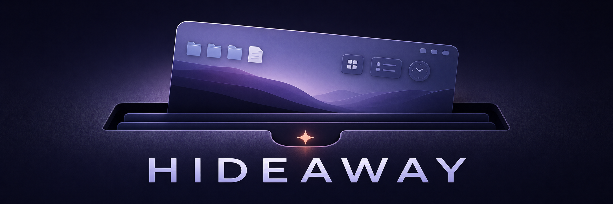

<p align="center">
  
</p>

<p align="center">
  A tiny native macOS menu-bar utility that tucks away visual clutter and restores everything exactly as it was.
</p>

<p align="center">
  <a href="https://github.com/Takhoffman/hideaway/actions/workflows/ci.yml"></a>
  <a href="LICENSE"></a>
  
</p>

## What it does

Click **Stash My Mac** to temporarily:

- hide desktop files without moving or deleting them;
- hide desktop widgets;
- turn on Dock auto-hide;
- turn on menu-bar auto-hide.

Hideaway snapshots every preference before it makes a change. Click **Restore My Mac** to put those exact values back—even after relaunching the app.

## Install

Download the latest `Hideaway.app` archive from [GitHub Releases](https://github.com/Takhoffman/hideaway/releases/latest), unzip it, and move the app to Applications.

Community builds are not yet Apple-notarized. On first launch, Control-click Hideaway, choose **Open**, then confirm **Open**. Subsequent launches work normally; in-app updates are protected by Sparkle signatures.

Hideaway checks for signed updates automatically with [Sparkle](https://sparkle-project.org/). You can also choose **Check for Updates…** from the popover.

## Build from source

You need macOS 13 or newer and the current Xcode Command Line Tools.

```sh
git clone https://github.com/Takhoffman/hideaway.git
cd hideaway
swift run Hideaway
```

`swift run` is convenient for development, but it does not include app-bundle metadata or automatic updates. To build the distributable universal app:

```sh
Scripts/build-app.sh 0.1.0 1
open dist/Hideaway.app
```

## Safety and privacy

Hideaway runs entirely on your Mac. It has no analytics, accounts, or data collection. It changes a small set of macOS preferences with the system `defaults` tool and restarts the affected system services so changes appear immediately.

An interrupted stash remains recoverable: Hideaway records the active session before changing preferences and keeps **Restore My Mac** available on the next launch.

## Automatic updates and releases

Release archives are signed with a project-specific Sparkle EdDSA key. The public key is embedded in the app; the private key is kept outside the repository. Tagged releases generate a signed appcast and publish it through GitHub.

Maintainers can find the release checklist in [CONTRIBUTING.md](CONTRIBUTING.md#releasing).

## Contributing

Bug reports and focused pull requests are welcome. Read [CONTRIBUTING.md](CONTRIBUTING.md), [SECURITY.md](SECURITY.md), and the [Code of Conduct](CODE_OF_CONDUCT.md) before participating.

## License

Hideaway is available under the [MIT License](LICENSE).
